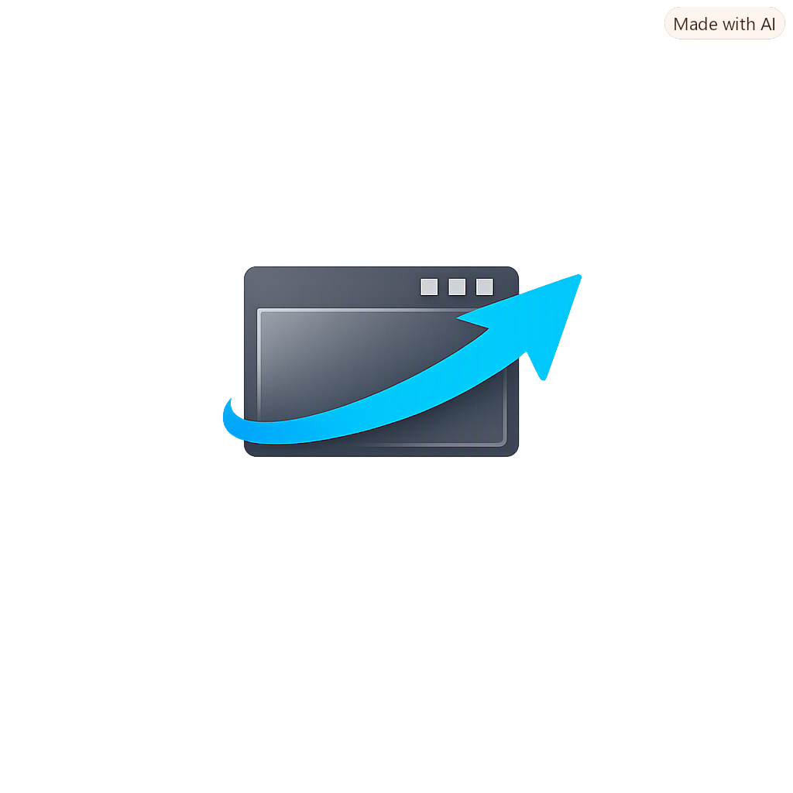

<p align="center">
  
</p>

# JumpScreen

**"Move to this display" and "Center on this display" — right-click any app's
taskbar button.** JumpScreen injects two tasks into other applications' Windows
taskbar jump lists, so you can fling a window (or rescue a lost one) to whichever
display you right-clicked on — no keyboard shortcuts, no dragging across
monitors.

## Features

- **Move to this display** — moves the app's window to the display containing
  the taskbar button you right-clicked, preserving relative position and size.
  Works with normal, maximized, and minimized windows.
- **Center on this display** — restores the window and centers it on that
  display. Handy for rescuing windows that ended up off-screen.
- **Works on (almost) every app** — not just ours. Jump lists are per-app, so
  JumpScreen injects its task into the jump list of every app it can identify —
  including apps that never declared an AppUserModelID (their system-generated
  ID is resolved via `IApplicationResolver`).
- **Self-healing** — a Task Scheduler entry re-registers the tasks every
  10 minutes, so apps that rewrite their own jump lists (VS Code, Chrome,
  WhatsApp) keep the option, and newly launched apps pick it up automatically.
- **Tiny** — a single ~900KB Rust binary, no runtime, no console window.

## Install

Grab `JumpScreenSetup.exe` from Releases — a per-user Inno Setup installer
(no admin required). It deploys the binary and runs `install` + `guard` for you.
Uninstalling removes the injected tasks and the scheduled entry.

## Manual usage

```console
jumpscreen install     # inject tasks into every discovered app's jump list
jumpscreen uninstall   # remove them all
jumpscreen guard       # register the 10-minute re-inject task (--off to remove)
jumpscreen list        # show discovered apps and registration state
jumpscreen debug       # dump taskbar windows with resolved AppIDs (diagnostics)
```

State lives in `%LOCALAPPDATA%\JumpScreen\` (`state.json`, `last-error.log`).

## How it works

The taskbar right-click menu **is** the app's Jump List — there's no extension
point for the menu itself, but `ICustomDestinationList::SetAppID` lets a process
inject a *task* into another app's list. Each task is an `IShellLink` that
launches `jumpscreen.exe move|center --aumid "<id>" --exe "<path>"`. On click,
the binary finds the display under the cursor (`GetCursorPos` →
`MonitorFromPoint`) — which is the display where the menu was opened — locates
the app's window, and repositions it via `SetWindowPlacement`.

## Build from source

```console
cargo build --release
# optional installer (needs Inno Setup 6):
"C:\Program Files (x86)\Inno Setup 6\ISCC.exe" installer\jumpscreen.iss
```

Stack: Rust, [`windows-rs`](https://crates.io/crates/windows) + clap, Inno Setup.

## Caveats

- Apps that actively manage their own jump lists can overwrite the task between
  guard cycles — re-running `install` restores it instantly.
- The task links embed the absolute path of `jumpscreen.exe`; if you move the
  binary, re-run `install` and `guard` from the new location.
